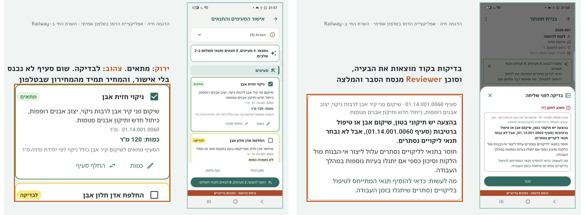

# Quote AI Assistant

[](https://github.com/shellybh/quote_ai_assistant/actions/workflows/ci.yml)

Final project, AI Developers course, The Hebrew University (2026). Reviewed and approved.

**The problem.** A building-conservation business writes price proposals on the phone by hand: picking lines from a 471-item catalog, adding conditions and payment terms, and checking everything before it is sent.

**The solution.** An AI server for the business's existing offline Flutter app (FastAPI, CrewAI Flow with three agents, Gemini). It turns a free-text message into suggested catalog lines, conditions and payment stages, and reviews a proposal before sending: missing conditions, unusual prices (by ratio only), wrong units and vague wording.

**The principle: AI suggests, a person approves, code computes.** The AI never sets or sees a price, every catalog code it returns is validated in code, and totals and VAT are computed only in the app.

## Demo


*Left: lines suggested from a free-text message (green = matched, yellow = needs a check). Right: review before sending: code finds the problem, the Reviewer agent explains it. Demo app, fictional data.*

Demo video (the server running on Railway during the course):

https://github.com/user-attachments/assets/47a89b17-6bba-43f7-b704-9b21dc70029b

## How it works

### What the server does

| Ability | Endpoint | What comes back |
|---|---|---|
| **A + A+: a proposal from a free-text message** | `POST /v1/match-items` | Catalog lines with quantities, conditions from the business's library and payment stages. The business owner approves each one in the app |
| **B: review before sending** | `POST /v1/review-proposal` | Missing condition, unusual price (by ratio only), wrong unit and vague wording, with an explanation and a suggestion |
| Health | `GET /health` | 200, no token |

Every request except `/health` needs a token (`Authorization: Bearer`). There are rate, size and time limits. A Gemini rate limit comes back as HTTP 429 with `Retry-After`.

### Architecture

```
Masked message from the phone
   │
   ▼
Intake (agent)       splits it into jobs, quantities, conditions and payment
   │                 code checks: a quantity only if the number is written; a percent that was not said is dropped
   ▼
Hybrid search        Hebrew normalisation → BM25 + Gemini embeddings → RRF → 15 candidates
   │
   ▼
Matcher (agent)      picks a line from the candidates, and conditions from the library
                     code checks: the code must be one of the candidates; confidence is computed in code

Proposal to review (codes, quantities, price ratios)
   │
   ▼
Fixed code checks    find the problems (rules.yaml)
   │
   ▼
Reviewer (agent)     writes the explanation and the suggestion for the business owner
```

- **Agents:** CrewAI Flow, model `gemini-3.5-flash-lite` through `google-genai`. Prompts are in [`prompts/`](prompts/); they were tried first in AI Studio ([`docs/ai_studio_notes.md`](docs/ai_studio_notes.md)).
- **Search** runs fully in memory, with no vector database. The index is kept by the catalog's hash, so embeddings are not recomputed on every request.
- **Business rules** (required conditions, conflicting pairs, special items) live in [`app/core/rules.yaml`](app/core/rules.yaml), not in the prompt.

## Evaluation

| What was measured (separate test set, two runs) | Code-only baseline | With AI |
|---|---|---|
| Review before sending: errors found | 75% | 100%, no false alarms |
| Conditions from the message (recall) | 78.8% (keywords) | 97%–100% |
| Search: the right item among 15 candidates | 87.5% (BM25) | 100% (hybrid) |
| Picking the right catalog item | — | 71% (tuning set: 100%) |

Prompts were tuned on the tuning sets only. Full details, including what does not work: [`docs/evaluation.md`](docs/evaluation.md). The sets are in [`eval/datasets/`](eval/datasets/), the raw results in [`eval/results/`](eval/results/).

## Limitations

- **Picking the catalog item is the weak spot:** 71% on the test set against 100% on the tuning set. Repeated misses include plaster repair vs. plaster renewal and size-sensitive picks (a shutter by its size).
- **A confident wrong line is not caught by the confidence threshold** when its search score is strong; the person approving the draft has to catch it.
- **Answers vary between identical runs** (the model's temperature of 1.0 cannot be changed), so every test set was run twice.
- **Payment:** one test run invented a payment plan for a message with no payment. A code guard was added afterwards and checked on the tuning and natural sets only, not rerun on the test set. A plan like "the rest in two equal payments" cannot be expressed as stages.
- **Review results are partly by construction:** the code checks catch every price, unit and condition error because the same rules planted them. The vague lines were written for this project, and a vague phrase inside the catalog's own wording is never flagged.
- **Labels:** the domain expert confirmed the match codes and three A+ test cases; the other A+ labels are the developer's.
- **Gemini free tier:** about 15 model calls a minute (the server answers 429 with `Retry-After`), and free-tier content is used by Google to improve its products, so only the public catalog and fictional text are sent. Real use needs a paid key.
- **Railway Serverless:** the first request after the server sleeps is slow and may return 502.
- Prices and limits in [`docs/limits_and_costs.md`](docs/limits_and_costs.md) were checked on 29.10.2026 and change quickly.

---

Full development history is kept in a private repository, available on request.
`SPEC x.y` in code comments refers to the design document of the app project, which is private.

---

# בעברית

שרת ה-AI למחולל הצעות מחיר של עסק לשימור מבנים. זה פרויקט הגמר בקורס "מפתחי AI".

האפליקציה עצמה היא אפליקציית Flutter בטלפון, והיא פרויקט נפרד ופרטי. היא שולחת לשרת טקסט מוסתר וקודים מהמחירון, ומקבלת הצעות לאישור. בפרויקט משתמשים רק באפליקציית דמו ובנתוני דמו.

**העיקרון המנחה:** ה-AI מציע, אדם מאשר, והקוד מחשב. ה-AI אף פעם לא קובע מחיר ולא רואה מחיר.

## מה השרת עושה

| יכולת | נקודת קצה | מה חוזר |
|---|---|---|
| **A + A+: הצעה מהודעה חופשית** | `POST /v1/match-items` | סעיפים מהמחירון עם כמות, תנאים מספריית העסק ושלבי תשלום. בעל העסק מאשר כל אחד באפליקציה |
| **B: בדיקה לפני שליחה** | `POST /v1/review-proposal` | תנאי חסר, מחיר חריג (לפי יחס בלבד), יחידה שגויה וניסוח מעורפל, עם הסבר והמלצה |
| בריאות | `GET /health` | 200, בלי טוקן |

כל בקשה חוץ מ-`/health` דורשת טוקן (`Authorization: Bearer`). יש הגבלת קצב, גודל וזמן. מגבלת קצב של Gemini חוזרת כ-HTTP 429 עם `Retry-After`.

השרת נפרס ב-Railway במהלך הקורס. הסרטון מראה אותו עובד.

## איך זה בנוי

```
הודעה מוסתרת מהטלפון
   │
   ▼
Intake (סוכן)       מפרק לעבודות, כמויות, תנאים ותשלום
   │                בדיקות בקוד: כמות רק אם המספר כתוב; אחוז שלא נאמר נמחק
   ▼
חיפוש היברידי       נרמול עברית → BM25 + embeddings של Gemini → RRF → 15 מועמדים
   │
   ▼
Matcher (סוכן)      בוחר סעיף מהמועמדים, ותנאים מהספרייה
                    בדיקות בקוד: מספר הסעיף חייב להיות אחד המועמדים; רמת הביטחון מחושבת בקוד

הצעה לבדיקה (קודים, כמויות, יחסי מחיר)
   │
   ▼
בדיקות קבועות בקוד  מוצאות את הבעיות (rules.yaml)
   │
   ▼
Reviewer (סוכן)     מנסח הסבר והמלצה לבעל העסק
```

- **סוכנים:** CrewAI Flow, המודל `gemini-3.5-flash-lite` דרך `google-genai`. הפרומפטים ב-[`prompts/`](prompts/). הם נוסו קודם ב-AI Studio ([`docs/ai_studio_notes.md`](docs/ai_studio_notes.md)).
- **החיפוש** רץ כולו בזיכרון, בלי מסד נתונים וקטורי. האינדקס נשמר לפי hash של המחירון, כדי לא לחשב embeddings מחדש בכל בקשה.
- **כללי העסק** (תנאים חובה, זוגות סותרים, סעיפים מיוחדים) נמצאים ב-[`app/core/rules.yaml`](app/core/rules.yaml), ולא בפרומפט.

## תוצאות (סט מדידה נפרד, שתי ריצות)

| מה נמדד | מדד בסיס בקוד | עם AI |
|---|---|---|
| בדיקה לפני שליחה: טעויות שנמצאו | 75% | 100%, בלי התרעות שווא |
| תנאים מתוך ההודעה (Recall) | 78.8% (מילות מפתח) | 97%–100% |
| חיפוש: הסעיף בין 15 המועמדים | 87.5% (BM25) | 100% (היברידי) |
| בחירת הסעיף הנכון | — | 71% (בסט הכוונון: 100%) |

הפרומפטים כווננו רק על סט הכוונון. הפירוט המלא, כולל מה לא עובד: [`docs/evaluation.md`](docs/evaluation.md). הסטים נמצאים ב-[`eval/datasets/`](eval/datasets/), והתוצאות הגולמיות ב-[`eval/results/`](eval/results/). המגבלות מפורטות בסעיף Limitations למעלה.

## פרטיות

- מחירים, הצעות, לקוחות ופרטי העסק לא יוצאים מהטלפון. בבדיקת הצעה נשלחים רק יחסי מחיר, שמחושבים בטלפון. השרת דוחה בקשה עם שדה שלא מוכר לו, ולכן גם בקשה שמנסה לשלוח מחיר.
- הטלפון מסתיר סכומים, טלפונים, מיילים ושם העסק לפני השליחה.
- נתוני הדמו: המחירון הציבורי לעבודות שימור (471 סעיפים), ותנאים והצעות בדיוניים ([`data/demo/`](data/demo/README.md)).
- לפני כל commit רצה בדיקה שחוסמת מילים מרשימה פרטית, למשל שם העסק או טלפונים. הרשימה עצמה לא נשמרת במאגר.

## הרצה מקומית

```bash
uv sync
cp .env.example .env        # ולמלא ערכים. הקובץ לא נשמר ב-Git
uv run pytest -q            # הבדיקות, בלי פנייה ל-Gemini
uv run uvicorn app.main:app --port 8765 --no-access-log
```

מדידה. עם `--agent` המדידה פונה ל-Gemini, ובלעדיו רץ מדד הבסיס:

```bash
uv run python eval/run_eval.py match --set tune            # החיפוש לבד
uv run python eval/run_eval.py match --set tune --agent    # הסוכנים
uv run python eval/run_eval.py aplus --set tune --agent
uv run python eval/run_eval.py review --set tune --agent
```

## איך לנסות בלי האפליקציה

האפליקציה לא נמצאת במאגר הזה. השרת הוא API רגיל ב-HTTP, ולכן כל לקוח יכול לפנות אליו: curl, Postman, או אפליקציה או אתר שתבנו בעצמכם. מי שעושה fork מריץ שרת משלו עם מפתחות משלו:

1. **הגדרות.** ב-`.env` ממלאים `GEMINI_API_KEY` (מפתח חינמי מ-Google AI Studio), `GEMINI_MODEL` (למשל `gemini-3.5-flash-lite`), ו-`APP_TOKEN`, שהיא סיסמה שבוחרים בעצמכם. אחר כך מפעילים את השרת כמו בסעיף "הרצה מקומית".
2. **גופי בקשה לדוגמה.** בתיקייה [`examples/`](examples/) יש שתי בקשות מוכנות, שנבנו מנתוני הדמו במבנה שהאפליקציה שולחת. אפשר לבנות אותן מחדש עם `python scripts/build_example_requests.py`.
3. **שליחה:**

```bash
TOKEN="<הערך של APP_TOKEN>"
URL="http://127.0.0.1:8765"

# A + A+: הצעה מהודעה חופשית
curl -X POST "$URL/v1/match-items" \
  -H "Authorization: Bearer $TOKEN" -H "Content-Type: application/json; charset=utf-8" \
  --data-binary @examples/match_request.json

# B: בדיקת הצעה לפני שליחה
curl -X POST "$URL/v1/review-proposal" \
  -H "Authorization: Bearer $TOKEN" -H "Content-Type: application/json; charset=utf-8" \
  --data-binary @examples/review_request.json
```

ב-Windows שולחים עברית ל-curl רק מקובץ (`--data-binary @...`), כמו בדוגמה.

### מה נשלח

- **match-items:** `text` היא ההודעה החופשית, אחרי שהטלפון הסתיר בה סכומים ופרטים מזהים. `catalog` הוא המחירון: קוד, תיאור ויחידה בלבד. `conditions` היא ספריית התנאים: מזהה וטקסט. ההודעה בדוגמה:
  > ניקוי וכיחול קיר אבן בכניסה, 40 מ"ר. החלפת אדן חלון אבן. הפיגום כלול במחיר. תשלום: 30% בתחילת העבודה והיתרה בסיום.
- **review-proposal:** `lines` הן שורות ההצעה. כל שורה כוללת קוד, תיאור, יחידה וכמות, וגם **יחסי מחיר** שהטלפון חישב: `history_ratio` (פי כמה מהחציון בהצעות קודמות), `history_count` ו-`catalog_ratio`. השורות נשלחות בלי מחיר. `condition_keys` הם התנאים שנבחרו. בדוגמה יש ארבע טעויות מכוונות: מחיר חריג, יחידה שגויה, תיאור מעורפל וחסר תנאי תשלום.

השרת דוחה כל שדה שלא מוכר לו (422), ולכן גם בקשה עם מחיר נדחית.

### מה חוזר (תשובות אמיתיות מקוצרות, 7.11.2026)

match-items, אחרי כ-12 שניות בהפעלה הראשונה:

```json
{
  "lines": [
    {"source_text": "ניקוי וכיחול קיר אבן", "catalog_code": "01.14.001.0060",
     "quantity": 40.0, "unit": "מ\"ר", "confidence": 0.88, "needs_review": false,
     "similar": ["01.10.001.0037", "01.10.001.0040", "01.04.001.0040"]},
    {"source_text": "החלפת אדן חלון אבן", "catalog_code": "01.10.001.0038",
     "quantity": null, "unit": "יח'", "confidence": 0.9, "needs_review": true}
  ],
  "conditions": [
    {"condition_id": "cond-scaffolding_included", "source_text": "הפיגום כלול במחיר", "needs_review": false},
    {"condition_id": "cond-payment", "source_text": "תשלום: 30% בתחילת העבודה והיתרה בסיום", "needs_review": false}
  ],
  "payment": [
    {"description": "בתחילת העבודה", "percent": 30.0},
    {"description": "בסיום", "is_remainder": true}
  ],
  "warnings": ["לא צוינה כמות עבור 'החלפת אדן חלון אבן'."]
}
```

הכמות של אדן החלון ריקה, כי לא נאמר מספר. האפליקציה שואלת את המשתמש. אין בתשובה מחיר: האפליקציה לוקחת את המחיר מהמחירון שלה לפי הקוד.

review-proposal, אחרי כ-6 שניות (כל ממצא כולל גם `why`):

```json
{
  "findings": [
    {"severity": "high", "kind": "missing_condition", "line_code": null,
     "problem": "לא נבחר תנאי תשלום בהצעה הנוכחית.",
     "suggestion": "יש להוסיף תנאי תשלום מוגדרים ומפורטים להצעה."},
    {"severity": "medium", "kind": "unit_mismatch", "line_code": "01.11.001.0070",
     "problem": "בסעיף 01.11.001.0070 נרשמה יחידת מידה מ' במקום מ\"ר המופיעה במחירון."},
    {"severity": "medium", "kind": "price_vs_history", "line_code": "01.09.001.0060",
     "problem": "בסעיף 01.09.001.0060 מחיר היחידה גבוה פי 2.3 מהחציון של הסעיף ב-6 הצעות קודמות."},
    {"severity": "low", "kind": "wording", "line_code": "01.29.001.0900",
     "problem": "התיאור \"עבודות שונות בגג לפי הצורך\" הוא כללי ומעורפל."}
  ]
}
```

התשובות של Gemini משתנות מעט מריצה לריצה. הקודים, סוגי הממצאים ורמות החומרה נקבעים בקוד.

### בניית לקוח משלכם

המבנה המלא של הבקשות נמצא ב-[`app/api/schemas.py`](app/api/schemas.py), והמבנה של התשובות ב-[`app/models/`](app/models/). מה שחשוב לדעת:
- כל בקשה חוץ מ-`/health` צריכה את הכותרת `Authorization: Bearer <APP_TOKEN>`.
- מחירים נשארים אצל הלקוח. ללקוח יש שלושה תפקידים: לשלוח יחסים במקום מחירים, להציג כל הצעה לאישור של אדם, ולחשב סכומים ומע"מ בעצמו.
- תשובה 429 פירושה שהגעתם למגבלת הקצב של Gemini. מחכים את מספר השניות שבכותרת `Retry-After`.

## הכנה אחרי clone

```bash
git config core.hooksPath .githooks
git config privacy.forbiddenWordsFile "<נתיב לרשימת המילים האסורות, מחוץ למאגר>"
python scripts/check_demo_data.py
```

## פריסה

השרת מוכן לפריסה ב-Railway (`railway.json`): מחברים את המאגר לשירות חדש, ומגדירים בו את המשתנים `APP_TOKEN`, `GEMINI_API_KEY` ו-`GEMINI_MODEL`. הם לא נשמרים במאגר. ה-CI ב-GitHub מריץ בכל push את הבדיקות ואת בדיקת נתוני הדמו.

## מבנה

| תיקייה | מה יש בה |
|---|---|
| `app/flows/` | תהליכי CrewAI: הצעה מהודעה ובדיקת הצעה |
| `app/agents/`, `prompts/` | הסוכנים והפרומפטים שלהם |
| `app/core/` | חיפוש, נרמול עברית, כללים ובדיקות בקוד |
| `app/api/`, `app/models/` | מבנה הבקשות והתשובות (Pydantic) |
| `eval/` | סטי כוונון ומדידה, מדדי בסיס, הרצת המדידה |
| `data/demo/` | נתוני הדמו |
| `examples/` | בקשות לדוגמה, לניסוי בלי האפליקציה |
| `docs/` | הערכה, ניסויי AI Studio, מגבלות ועלויות |

## טכנולוגיות

Python 3.12 · uv · FastAPI · CrewAI Flow · Gemini (`google-genai`) · bm25s · rapidfuzz · Railway · GitHub Actions
